# 🔎 NewsLens

**A multi-agent news analyst that researches a topic across Google News, Hacker News and Reddit, groups articles into stories, extracts claims, verifies every claim against its sources, and writes a neutral briefing where every line is cited and single-source claims are flagged.**

[](https://github.com/AakashRanjan1811/NewsLens/actions/workflows/ci.yml)


> On a labelled benchmark, the verifier caught **34/34 fabricated claims** (altered numbers, swapped entities, invented facts) while accepting **14/14 paraphrased true claims**, and **0/9** fabrications injected into the pipeline reached the published briefing. See [Evaluation](#-evaluation).

---

## Why

LLM news summarisers have two classic failure modes: they **hallucinate** (wrong numbers, wrong company) and they **launder rumours** (one Reddit post becomes "reports say"). NewsLens treats the LLM as a fast but untrusted junior analyst:

- **LLMs do the language work:** planning searches, extracting claims, writing.
- **Deterministic agents do the checking:** every claim is matched against the source text, every briefing bullet is reviewed, and anything that fails is sent back or removed.

## 🏗 Architecture

```mermaid
flowchart LR
    T([Topic]) --> P[Planner<br/>LLM: search queries]
    P --> C[Collector<br/>Google News RSS · HN · Reddit]
    C --> K[Clusterer<br/>TF-IDF + agglomerative]
    K --> A[Analyst<br/>LLM: claims per story]
    A --> V[Verifier<br/>numbers · names · word overlap]
    V --> W[Writer<br/>LLM: cited briefing]
    W --> R{Critic<br/>rules}
    R -- "issues → revise (max N)" --> W
    R -- ok / out of revisions --> F[Finalize<br/>drop failing bullets, render]
    F --> B([Briefing + sources])
```



| Agent | Type | Job |
|---|---|---|
| Planner | LLM | Turns the topic into ≤4 distinct search queries + a focus statement |
| Collector | Tool | Fetches Google News RSS, Hacker News (Algolia API) and Reddit; dedupes; one failing source never stops the run |
| Clusterer | ML | TF-IDF (1–2 grams) + agglomerative clustering on cosine distance → stories, ranked by number of publishers |
| Analyst | LLM | Extracts ≤3 factual claims per story with the article IDs that state them |
| Verifier | Rules | A claim is supported by an article only if **all its numbers**, **all its names** and **nearly all its content words** are in that article. Labels each claim `corroborated` (2+ publishers), `single_source`, or `unsupported` |
| Writer | LLM | Writes bullets from verified claims only, citing claim IDs |
| Critic | Rules | Rejects unknown/unsupported claims, numbers not in the claims, duplicate bullets, and **single-source claims stated as fact** |
| Finalize | Rules | After max revisions, drops any bullet that still fails (fail-safe), renders Markdown with numbered sources |

## 📊 Evaluation

`python -m eval.evaluate` (offline, reproducible; runs in CI)

**1. Story clustering** — 22 articles, 9 human-labelled stories

| distance threshold | stories found | ARI | homogeneity | completeness |
|--:|--:|--:|--:|--:|
| 0.6 | 13 | 0.723 | 1.000 | 0.854 |
| 0.7 | 9 | 1.000 | 1.000 | 1.000 |
| **0.8 (default)** | 9 | **1.000** | 1.000 | 1.000 |
| 0.9 | 9 | 1.000 | 1.000 | 1.000 |

**2. Fabricated-claim detection** — 14 paraphrased true claims vs 34 fabricated variants

| fabrication type | caught |
|:--|--:|
| altered number ("3,200 scooters" → "4,800") | 10/10 |
| swapped entity ("Zephyr Mobility" → "Voltara Motors") | 10/10 |
| invented extra fact ("… after its chief executive resigned") | 14/14 |
| **true claims wrongly rejected** | **0/14** |

**3. End-to-end injection** — an analyst that slips one fabricated claim into every story: **9/9 flagged unsupported, 0/9 published.**

**Limitations (stated honestly)**
- The benchmark corpus is small, **fictional** and hand-written, so it is cleaner than real news; expect lower numbers on live feeds. The clustering threshold and the `MAX_UNMATCHED_WORDS = 2` paraphrase limit were chosen on this corpus.
- The verifier is lexical: it can reject a correct claim that is heavily reworded, and it cannot catch a fabrication that reuses the source's exact words in a misleading way. An NLI/entailment model would be the next step (see [docs/DESIGN.md](docs/DESIGN.md)).
- Live collection uses article titles and RSS snippets, not full article text.

## 🚀 Quick start

```bash
git clone https://github.com/AakashRanjan1811/NewsLens.git
cd NewsLens
python -m venv .venv
# Windows:  .venv\Scripts\activate      macOS/Linux:  source .venv/bin/activate
pip install -r requirements.txt
cp .env.example .env          # Windows: copy .env.example .env
streamlit run app.py          # http://localhost:8501
```

Runs **offline out of the box** on the sample corpus with the mock analyst. For real use, choose **Live news** in the sidebar and an LLM:

| Provider | Setup |
|---|---|
| **Groq** (free, fast) | Key from [console.groq.com/keys](https://console.groq.com/keys); set `LLM_PROVIDER=groq`, `GROQ_API_KEY=...` (or paste in the sidebar) |
| **Ollama** (local) | `ollama pull llama3.2:3b`; set `LLM_PROVIDER=ollama` |

### Command line

```bash
python -m newslens --sample ev_two_wheelers            # offline demo
LLM_PROVIDER=groq python -m newslens "electric two-wheelers India" --out briefing.md
```

### Docker

```bash
docker build -t newslens .
docker run -p 8501:8501 --env-file .env newslens
```

### Deploy on Streamlit Community Cloud
Point a new app at `app.py` and add `GROQ_API_KEY` and `LLM_PROVIDER = "groq"` under **Settings → Secrets**.

## 🧪 Tests

```bash
pip install -r requirements-dev.txt
pytest          # 34 tests, fully offline
ruff check .
```

Covers RSS/HN/Reddit parsing (fixtures, malformed items), dedupe, clustering vs labels, every verifier rule (including the "sentence-initial word is not a name" edge case), every critic rule, the fail-safe, routing, end-to-end runs, fabrication injection, a "stubborn" writer that ignores feedback, LLM errors, source outages, LLM retry logic, the CLI and the Streamlit dashboard. CI runs on Python 3.11 and 3.12.

## 📁 Project structure

```
newslens/
  config.py          settings from env / .env
  schemas.py         Pydantic contracts (Article, Story, Claim, Briefing, ...)
  sources.py         collectors + pure parsers + sample loader
  clustering.py      TF-IDF + agglomerative story clustering
  llm.py             Groq / Ollama / Mock behind one structured-output interface
  graph.py           LangGraph pipeline, writer-critic loop, Markdown rendering
  agents/
    llm_agents.py    planner, analyst, writer prompts
    verifier.py      claim-vs-source support checks
    critic.py        briefing rules + fail-safe
  __main__.py        CLI
app.py               Streamlit dashboard
eval/evaluate.py     benchmark
data/samples/        fictional labelled corpus
tests/               pytest suite
docs/DESIGN.md       design decisions & trade-offs
```

## License

MIT
